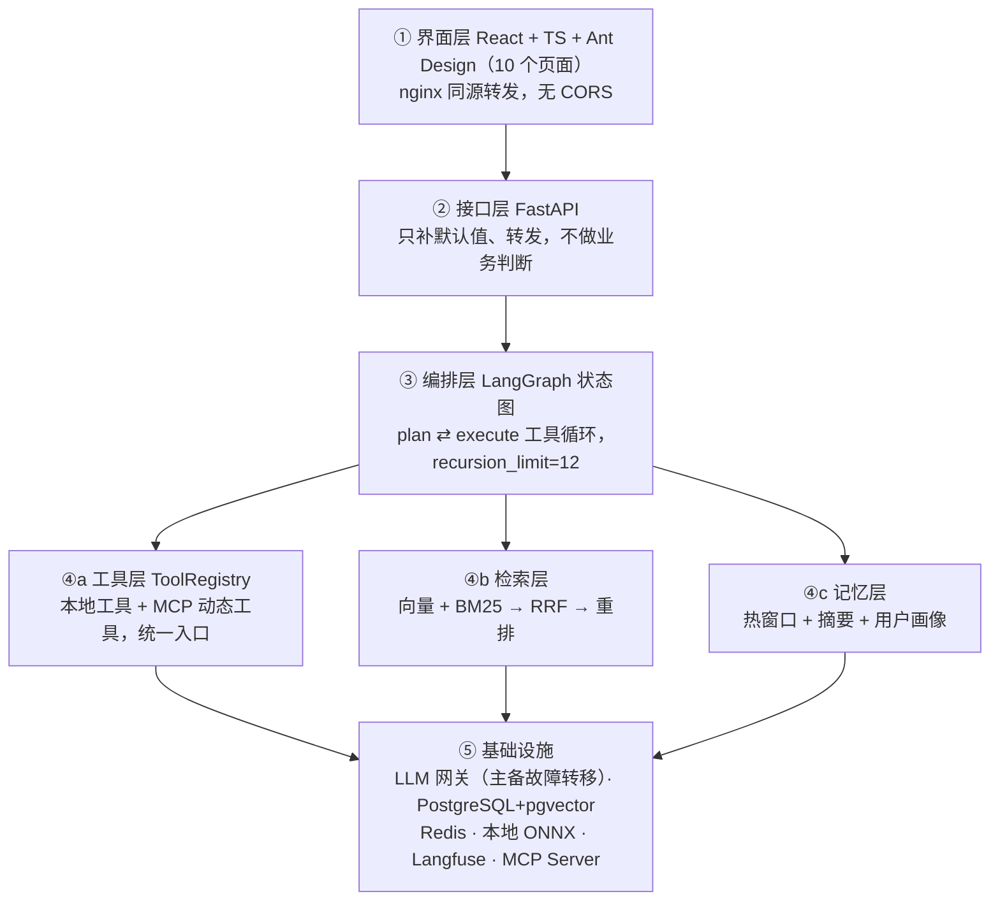
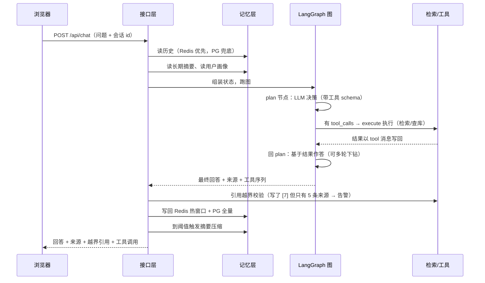

# AgentForge-Lite 面试讲解稿

> 用途：面试重点项目讲解。里面有「一句话介绍 → 架构 → 亮点 → 话术 → 追问」，数字都来自代码，可直接背。

---

## 1. 一句话介绍（电梯陈述）

**AgentForge-Lite 是一个企业级、可自托管的 Agent 运行时平台，把「文档知识库 → 检索增强问答 → 工具调用 → 效果评测」四条链路收进一个进程里。**

员工用自然语言提问，系统返回**带出处的回答**；知识库覆盖不到的，Agent 自动调外部系统工具继续查；每次回答的效果还能被量化评测。

**技术栈一句话**：FastAPI + Pydantic v2 + LangGraph 做后端编排，PostgreSQL 16 + pgvector 做向量存储，Redis 做会话缓存，本地 ONNX 模型做嵌入和重排，Langfuse 做全链路追踪，React + TypeScript + Ant Design 做前端，Docker Compose 一键起。

**规模**：后端约 2 万行 Python，前端 10 个页面，400+ 测试用例。

---

## 2. 项目背景（为什么做）

企业内部有大量制度、手册、FAQ 文档，但两个痛点：

1. **检索靠关键词翻页**——搜不到、也搜不全，问答靠人工转述；
2. **直接用大模型问答会幻觉**——它不知道公司内部规定，容易一本正经地编。

所以做这个平台：文档统一入库、切分、向量化，先检索再让模型**基于原文**回答，回答带出处可溯源；答不了的自动调工具；并且用一套评测体系回答「这东西到底准不准」。

---

## 3. 整体架构（五层）

**分层的判据不是「分了目录」，而是每一层都只有一个对外出口**，出口唯一才谈得上替换：

| 层 | 唯一出口 | 替换什么不用改业务 |
|---|---|---|
| LLM 调用 | `llm_gateway.chat()` | 换模型厂商、加通道 |
| 工具 | `execute_tool()` / `get_tools_schema()` | 加工具、接外部系统 |
| 检索 | `retrieve()` | 切换检索策略 |
| 记忆 | `get_window()` / `append_turn()` | 换缓存实现 |

---

## 4. 一次问答的端到端流程

**图内部只有两个节点**：`plan`（LLM 决策 + 作答）和 `execute`（执行工具），组成循环。

> 一个真实优化：最初图是 `plan → (execute | answer)`，answer 节点又调一次 LLM。实测发现不需要工具时 plan 已经把答案说完了，一轮白烧一次调用。后来把回答规范并进 plan 的 prompt，**无工具轮 LLM 调用从 2 次降到 1 次，有工具轮从 3 次降到 2 次**。

---

## 5. 七大技术亮点（面试重点）

### 亮点 1：混合检索 + RRF 融合 + 重排，且三配置可切换

- **向量检索**：本地 bge-small-zh ONNX 模型把问题转成 512 维向量，pgvector 按余弦距离排序，擅长「意思相近」；
- **关键词检索**：jieba 分词后走 PostgreSQL tsvector 的 GIN 倒排筛候选，再用 BM25 公式（词频饱和 + 长度归一化 + 稀有度）打分，擅长「精确字面」，比如型号、比例数字；
- **RRF 融合**：`score = Σ 1/(60+rank)`，**只取各路名次、丢掉原始分数**。因为 cosine 分在 [0,1]、BM25 分无上界，加权求和会被 BM25 完全主导，而且分数分布随查询漂移；名次是序数量，天然同量纲；
- **交叉编码器重排**：RRF 取 20 条候选，bge-reranker 把 [问题, 文档] 拼起来逐层精算相关性，取 top 5。RRF 只能仲裁「两路意见不一致」，重排能纠正「两路一致但都错」；
- **三配置统一入口** `retrieve()`：`pure_vector / hybrid / hybrid_rerank`，为消融实验刻意保留，同一个评测集跑三遍，用数据回答「重排到底有没有用」。

### 亮点 2：工具动态发现，接外部系统 Agent 引擎零改动

- 工具不是写死在代码里的。MCP 客户端启动一台 server 后，调 `tools/list` **现取**工具名、描述、参数 schema，为每个工具动态造一个代理函数（stub）注册进注册表；
- 对 LLM 来说，进程内的真函数和跨进程的代理**完全无区别**，它只认工具名；
- 实测接入 Harness 官方 MCP Server（11 个工具）时，**Agent 引擎一行代码没改**。这就是 MCP 的核心价值。

### 亮点 3：处处可降级，而且降级可归因

- **LLM 双通道**：主通道 DeepSeek 失败自动切备用 OpenAI 中转，两个通道都挂才失败；
- **重排降级**：模型加载失败或推理超时，返回融合序结果，不把请求打成 500；并用 `retriever` 字段标记「实际走通的是哪条路」，评测时不会把降级样本算成重排的成绩；
- **外部工具缺失**：连不上 MCP server 时自动降级为纯知识库问答，不阻断主流程；
- **Redis 是可以坏的一层**：所有 Redis 操作过容错封装，失败只记日志，读失败走 PG 兜底。

> 关键认识：**降级会让「用了哪个通道」从数据里消失，所以评测的 judge 要支持通道锁定**——指定通道、失败就抛、不偷偷换，否则一份报告里一半样本是 A 模型打的分、一半是 B 模型打的，分数不可比。

### 亮点 4：工具沙箱，最小权限容器隔离

用户可以上传一个 Python 写的 MCP Server，平台把它跑在 Docker 隔离容器里，自动发现工具。隔离参数：

- `--network none`（无网络）、`--read-only`（根文件系统只读）、`--tmpfs /tmp:noexec,nosuid`（唯一可写处是内存盘、不可执行、16MB 上限）；
- 非 root 用户、`--cap-drop ALL`（丢弃全部内核特权）、`no-new-privileges`（禁止 setuid 提权）；
- 内存 / CPU / 进程数上限（防 fork 炸弹）；代码目录只读挂载。

而且复用了已有的 MCP 客户端：对它来说 command 是 `python` 还是 `docker` 都是「起子进程聊 JSON-RPC」，**引擎和注册表零改动**。

### 亮点 5：评测闭环，把「效果」变成可量化指标

- **两阶段**：先生成所有答案并落库，再统一打分。因为实测发现「重复 3 次」该重复的是裁判（judge 有抖动），不是生成（答案本身没生成好，重复打分没用）。拆开后生成串行（重排吃 CPU、并发会抢核）、打分并发（纯等 HTTP）；
- **LLM 裁判三维度**：correctness（正确性）、faithfulness（引用忠实度）、completeness（完整性），各打 0-5 分，评分标准（rubric）是唯一权威，每一档判据都写死，不让模型自由发挥；
- **多次打分取中位数**，等价多数投票，压裁判抖动；
- **失败归因用纯函数推导**（failure_taxonomy），不让模型生成失败原因——否则 5 次调用会写出「检索未命中 / 资料缺失 / 没找到」等同义异形，聚类出来是假的。归因分五类：系统错误、工具未调对、编造内容、回答不完整、答案错误；
- **指纹冻结**：评测集和语料都算指纹，不一致拒绝跑，保证结果可复现；
- 工具类题不打分：判「有没有选对工具」是确定性判定，答案可能答对却完全没查库，工具序列是唯一依据。

### 亮点 6：语义层，不让 LLM 直接生成 SQL

- 数据分析（Agentic BI）场景，**LLM 只选「指标名 + 维度 + 时间窗」，SQL 由 metrics.yaml 模板渲染**；
- 三层防护：指标名白名单、维度白名单（占位符只会被白名单原文替换）、时间参数走绑定不拼接；
- 从根上消除 NL2SQL 的风险——模型生成的 SQL 可能跑错数、删库、越权，事后校验堵不住，根本不让它生成 SQL；
- 双数据源（项目库 SQL + Langfuse API）输出统一 schema，上层无感知；业务时区统一按北京时间显式换算，不依赖数据库会话时区。

### 亮点 7：四层记忆 + 多租户隔离

- **四层记忆**：单轮上下文（内存）→ Redis 热窗口（最近 8 轮，24h TTL，upsert 写回）→ 会话摘要（超 20 轮触发，LLM 增量合并、温度 0.1 防加戏）→ **用户画像**（跨会话稳定的事实与偏好，换会话仍成立，自动抽取 + 显式填写）；
- 摘要和画像都放 system prompt 且单独走 state 字段，不插进 messages——插进去会伪装成真实对话轮次，干扰引用编号判断；
- **多租户行级隔离**：5 张核心表加 `owner_id`，检索 SQL 里直接加归属过滤。BM25 的三个统计量（语料 N/平均长度、词的文档频率）都要加归属条件，否则会有「统计量侧信道」——别人文档里的常用词会悄悄压低你的候选分。

### 加分项：全链路可观测

- Langfuse 四层埋点：根 agent span、generation、检索父 span、工具 span；
- **失败也留痕**：只写日志的话，「某台 server 的工具一直失败」在追踪面板上看不见；
- 根 span 只覆盖「用户等待的全部」（到取结果为止），**不含写回副作用**，否则延迟统计失真，而这个延迟之后要当指标读。

---

## 6. 面试话术（三个版本）

### 30 秒版

> AgentForge-Lite 是一个企业级、可自托管的 Agent 运行时平台，把文档知识库、检索增强问答、工具调用和效果评测四条链路收进一个进程。后端用 FastAPI + LangGraph，PostgreSQL 加 pgvector 存向量，Redis 做会话缓存，React 做前端。核心是混合检索加 RRF 融合加重排保证答得准，MCP 协议动态接入外部工具时引擎零改动，还有一套评测体系把回答效果量化。

### 2 分钟版

> 这是个解决企业内部文档问答的平台。企业有大量制度、手册，直接用大模型问答会幻觉，因为它不知道公司内部规定。所以我们把文档入库、切分、向量化，提问时先检索再让模型基于原文回答，回答带出处。
>
> 架构上分五层：界面、FastAPI 接口、LangGraph 编排、工具/检索/记忆三个能力层、底层基础设施。编排是一个 plan 加 execute 的状态图循环，支持多轮工具调用。
>
> 检索是我做的重点：向量检索擅长语义，BM25 擅长精确字面，两路并发用 RRF 按名次融合，再用交叉编码器重排取 top5。这三种配置都保留了，在同一评测集上跑消融实验，用数据验证每一步的收益。
>
> 另外两个亮点：一是工具通过 MCP 协议动态发现，接 Harness 官方 11 个工具时 Agent 引擎一行没改；二是整套系统处处可降级且可归因，LLM 主通道挂了自动切备用、重排挂了返回融合序，而评测的裁判支持通道锁定，保证分数可比。

### 5 分钟版（按演示七段讲）

1. 架构开场（五层 + 每层唯一出口）；
2. 知识库上传（四种格式、PDF 保留页码、内容哈希幂等、异步入库）；
3. 检索问答（混合检索 + RRF + 重排 + 引用溯源）；
4. 外部系统互操作（MCP 动态发现、工具沙箱）；
5. 数据分析（语义层，LLM 不写 SQL）；
6. 评测（两阶段 + 三维度裁判 + 纯函数归因 + 指纹）；
7. 可观测（Langfuse 全链路追踪）。

---

## 7. 高频追问 & 简答

**Q1：RAG 完整流程？**
文档解析 → 切分（300 字一片、50 字重叠）→ 嵌入转向量 → 存 pgvector；提问时问题转向量 → 检索 top-k → 拼进 prompt → 模型基于片段作答，带出处。

**Q2：为什么切分要重叠？**
不重叠可能把一句话切成两半，两片语义都不完整，检索到也帮不上模型。

**Q3：为什么用 RRF 而不是加权分数融合？**
向量分和 BM25 分量纲不同、分布随查询漂移，加权的权重是摆设；RRF 只取名次，天然同量纲、不受分数分布影响。

**Q4：重排为什么更准？代价是什么？**
交叉编码器把问题和文档拼一条序列逐层交叉注意力，能读内容层面的相关性，而向量只是两个独立向量算距离。代价是慢：20 条候选约 750~820ms，CPU 密集，且无法预计算、不能缓存。

**Q5：怎么防幻觉？**
三道：① 只让模型基于检索片段回答，prompt 禁止写片段里没有的内容；② 引用必须标编号，回答后做越界校验，写了不存在的编号就告警；③ 评测用 faithfulness 维度量化引用忠实度。

**Q6：Agent 循环怎么实现的？**
LangGraph 状态图，plan 节点让 LLM 决定调工具还是作答，有 tool_calls 走 execute 执行、结果以 tool 消息写回再回 plan，没有就结束。递归上限显式设 12，防止无限循环。

**Q7：function calling 的消息协议？**
assistant 消息带 tool_calls，tool 消息必须带 tool_call_id 关联返回，缺了会 400。

**Q8：MCP 是什么？**
Model Context Protocol，让 Agent 用统一协议接入外部工具/数据源的开放标准。客户端起 server 进程，握手后调 tools/list 发现工具，调用走 JSON-RPC。

**Q9：为什么工具要动态发现而不是写死？**
写死的话加一台 server 要改代码、改能力清单，两处维护必然漂移；动态发现接新 server 引擎零改动。

**Q10：上传的工具安全吗？**
跑在最小权限容器里：无网络、只读根文件系统、非 root、丢全部内核能力、禁止提权、内存 CPU 进程数都有上限，代码目录只读挂载。

**Q11：LLM 服务挂了怎么办？**
网关主通道失败自动切备用通道，每次调用都记追踪；用户指定模型时走锁定，失败不偷偷换，保证归因真实。

**Q12：流式和非流式降级有什么区别？**
非流式失败可以直接换通道重来、用户无感；流式如果已经吐出半截答案再换通道，屏幕会变成两段话拼一起，所以「出字即锁」——一个字没出才允许降级。

**Q13：长对话上下文爆了怎么办？**
Redis 只存最近 8 轮；超 20 轮把滑出窗口的内容用 LLM 压成摘要（温度 0.1 防改事实），下轮把摘要拼进 system prompt。

**Q14：摘要和用户画像的区别？**
摘要是「这个会话刚才聊了什么」，换会话就没了；画像是「这个人是谁」，跨会话稳定，判据是换新会话它还成立。

**Q15：评测为什么拆生成和打分两阶段？**
实测抖动主要在裁判侧，重复该重复裁判；拆开后生成次数、打分次数独立，还省钱——整条链路重复 3 次要多花 3 倍生成成本，买到的还是同一份答案。

**Q16：裁判自己抖动怎么办？**
同一份答案打 3 次取中位数（等价多数投票），且裁判锁定通道、固定 rubric，把变量压到最少。

**Q17：失败原因为什么用代码算而不是让模型写？**
模型写自由文本会出现同义异形、不可复现、没法写断言；纯函数归因可单测、可复算。

**Q18：为什么不让 LLM 直接生成 SQL？**
生成的 SQL 可能跑错数、删库、越权，事后校验堵不住；语义层让它只选指标和维度，SQL 模板渲染 + 白名单 + 参数绑定，从根上消除风险。

**Q19：多租户怎么隔离？**
核心表加 owner_id，检索 SQL 加归属过滤；BM25 的语料统计和词频统计也要加归属，否则有统计量侧信道。

**Q20：文档重复上传怎么处理？**
上传前算原始字节的 sha256 做内容指纹，已就绪返回 409、处理中返回 409、失败记录抢锁原地重试；解析在后台，状态和切片在同一事务提交，不会出现「切片写了但状态还在 processing」。

---

## 8. 可量化数据（背数字，回答更有说服力）

| 项 | 数据 |
|---|---|
| 切片大小 / 重叠 | 300 字 / 50 字 |
| 嵌入模型 / 维度 | bge-small-zh ONNX / 512 维 |
| 融合候选窗口 / 最终返回 | 20 条 / 5 条 |
| RRF 常数 k | 60 |
| BM25 参数 | k1=1.2，b=0.75 |
| 重排耗时 | 20 条约 750~820ms |
| 重排模型加载 | 约 634~790ms（本地缓存） |
| 图递归上限 | 12 |
| 热窗口 | 8 轮，24h TTL |
| 摘要触发阈值 | 20 轮，温度 0.1 |
| 密码哈希 | bcrypt，成本因子 12（约 166ms/次） |
| token 有效期 | access 2h / refresh 7d |
| 登录失败锁定 | 5 次锁 5 分钟 |
| 后端规模 | 约 2 万行 Python |
| 测试规模 | 400+ 用例（单元 / 集成 / 安全三层） |
| 容器编排 | db / redis / api / web 四个服务 |
